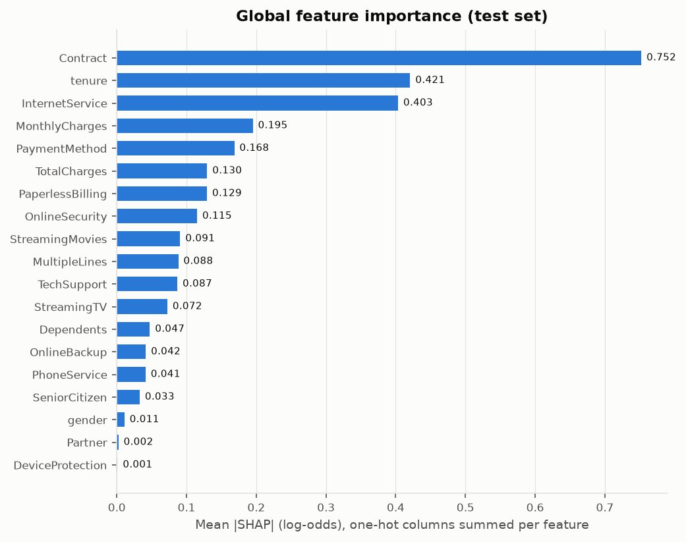
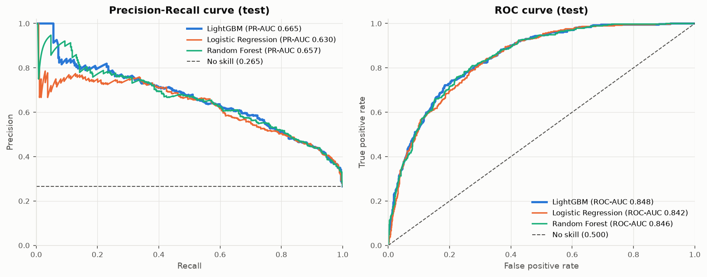
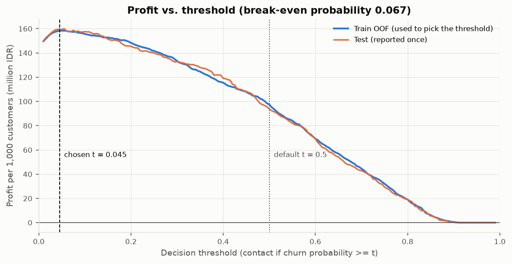

# Prediksi Churn Pelanggan Telco

Model machine learning yang memprediksi pelanggan telco mana yang berisiko berhenti berlangganan (*churn*), menjelaskan **mengapa** pelanggan itu berisiko, dan menentukan **siapa yang layak diberi penawaran retensi** berdasarkan perhitungan biaya dalam Rupiah.

Semua angka di README ini berasal dari kode yang dijalankan di repo ini (lihat folder `reports/`). Seluruh pipeline bisa dijalankan ulang dan menghasilkan file yang identik.



---

## 1. Masalah bisnis

Kehilangan pelanggan mahal: pendapatan bulanan hilang, dan mendapatkan pelanggan baru biasanya lebih mahal daripada mempertahankan yang lama. Tim retensi punya anggaran terbatas untuk diskon, telepon, atau bonus, jadi pertanyaannya adalah:

1. **Siapa** yang kemungkinan besar akan churn?
2. **Mengapa** mereka berisiko?
3. **Siapa yang layak dihubungi**, mengingat setiap penawaran punya biaya dan tidak selalu berhasil?

Proyek ini menjawab ketiganya dengan model klasifikasi, interpretasi SHAP, dan analisis threshold berbasis biaya.

## 2. Data

| Item | Keterangan |
|---|---|
| Dataset | IBM Telco Customer Churn (IBM Sample Data Sets) |
| Sumber | Hugging Face [`scikit-learn/churn-prediction`](https://huggingface.co/datasets/scikit-learn/churn-prediction), lisensi CC BY 4.0 |
| Ukuran | 7.043 pelanggan × 21 kolom (demografi, layanan, kontrak, tagihan, target `Churn`) |
| Target | 1.869 churn (26,5%) vs 5.174 tidak churn |

Detail sumber, revisi, tanggal unduh, dan checksum ada di [data/README.md](data/README.md).

**Penting:** data ini **sintetis**, dibuat IBM sebagai contoh. Tagihannya dalam USD, dan polanya **belum tentu mewakili pelanggan telco di Indonesia**.

## 3. Metodologi

| Fase | Yang dikerjakan | Keputusan utama dan alasannya |
|---|---|---|
| 1. Data dan EDA | Unduh otomatis dengan validasi, cek tipe data, nilai hilang, distribusi | 11 `TotalCharges` kosong, semuanya pelanggan `tenure = 0` (belum pernah ditagih), lalu diisi 0. Aturan per baris ini tidak menghitung statistik dari data, sehingga aman dari leakage. |
| 2. Preprocessing | `ColumnTransformer`: imputasi + scaling (numerik), imputasi + one-hot (kategorikal). Split stratified 80/20, `random_state=42` | Preprocessor menjadi langkah pertama dalam `Pipeline` model, jadi di-fit ulang di setiap fold CV pada data train saja. "No internet service"/"No phone service" digabung ke "No" karena informasinya dobel dengan `InternetService`/`PhoneService`. |
| 3. Modeling | Logistic Regression, Random Forest, LightGBM. Stratified 5-fold CV, `RandomizedSearchCV` | class_weight dan SMOTE diuji **di dalam CV** (SMOTE hanya di fold train lewat `imblearn.Pipeline`). Keduanya tidak menaikkan PR-AUC dan justru membuat probabilitas terlalu tinggi, sehingga model final dilatih tanpa pembobotan dan imbalance ditangani lewat threshold di fase 5. |
| 4. Evaluasi | Data test dipakai **sekali**. PR-AUC, ROC-AUC, precision, recall, F1, Brier, confusion matrix, bootstrap CI | PR-AUC menjadi metrik utama karena kelas churn minoritas; akurasi menyesatkan. |
| 5. Threshold berbasis biaya | Kurva profit per threshold dalam Rupiah | Threshold dipilih dari prediksi *out-of-fold* data train, bukan dari data test. Asumsi biaya bisa diubah di [src/config.py](src/config.py). |
| 6. Interpretasi | SHAP global dan lokal (TreeExplainer) | Kontribusi kolom one-hot dijumlahkan kembali per fitur asli (sah karena SHAP aditif). |
| 7. Aplikasi | Streamlit: input data pelanggan, output probabilitas, keputusan, dan faktor penyebab | Aplikasi memakai pipeline joblib dan aturan cleaning yang sama dengan training. |

## 4. Hasil

### Pemilihan model (5-fold CV di data train)

| Model | PR-AUC | ROC-AUC | Brier |
|---|---|---|---|
| Logistic Regression | 0,662 ± 0,019 | 0,846 | 0,135 |
| Random Forest | 0,665 ± 0,022 | 0,847 | 0,135 |
| **LightGBM (terpilih)** | **0,670 ± 0,019** | **0,850** | **0,134** |

LightGBM unggul tipis tetapi konsisten (menang di 5 dari 5 fold atas Logistic Regression, selisih rata-rata +0,009 PR-AUC). Konfigurasi terbaiknya sangat sederhana (`num_leaves=4`), yang menjelaskan kenapa model linear hampir setara.

### Evaluasi akhir (data test, 1.409 pelanggan, 374 churn)

| Metrik | LightGBM | Pembanding |
|---|---|---|
| PR-AUC | **0,665** (95% CI 0,612–0,713) | tebakan acak: 0,265 |
| ROC-AUC | **0,848** (95% CI 0,827–0,869) | tebakan acak: 0,500 |
| Brier score | 0,135 | |
| Precision / Recall / F1 @ threshold 0,5 | 0,660 / 0,524 / 0,584 | |
| Accuracy @ threshold 0,5 | 0,802 | selalu menebak "tidak churn": 0,735 |

Skor test sejalan dengan CV (0,665 vs 0,670), jadi tidak ada tanda overfitting. Probabilitasnya terkalibrasi: rata-rata prediksi 0,266 vs churn aktual 0,265.

<p>

</p>

### Threshold berbasis biaya

Asumsi default di [src/config.py](src/config.py): biaya penawaran **Rp 50.000**, kerugian per pelanggan churn **Rp 1.500.000**, tingkat keberhasilan retensi **50%**.

| Kebijakan (data test) | Threshold | Dihubungi | Churn tertangkap | Profit |
|---|---|---|---|---|
| **Threshold optimal (dipilih dari OOF train)** | **0,045** | 1.055 | 370 / 374 | **Rp 224.750.000** |
| Threshold default | 0,5 | 297 | 196 / 374 | Rp 132.150.000 |
| Hubungi semua pelanggan | 0 | 1.409 | 374 / 374 | Rp 210.050.000 |

Dengan asumsi default, penawaran sangat murah dibanding kerugiannya, sehingga menghubungi hampir semua pelanggan sudah menguntungkan. Model hanya unggul Rp 14,7 juta (sekitar 7%) atas "hubungi semua". **Nilai model naik saat penawaran lebih mahal:** dengan biaya Rp 200.000, model unggul Rp 106,6 juta dan "hubungi semua" justru merugi. Lihat 24 skenario di `reports/threshold_sensitivity.csv`.



### Faktor risiko utama (SHAP)

| Peringkat | Fitur | Arah pengaruh |
|---|---|---|
| 1 | Kontrak | Kontrak bulanan menaikkan risiko; kontrak 2 tahun paling menurunkannya |
| 2 | Lama berlangganan | Risiko tertinggi di bulan-bulan awal, menjadi netral sekitar bulan ke-20 |
| 3 | Layanan internet | Fiber optic menaikkan risiko |
| 4 | Tagihan bulanan | Risiko naik tajam di atas sekitar 95 USD (tidak linear) |
| 5 | Metode pembayaran | Electronic check menaikkan risiko |

### Rekomendasi bisnis

Ringkasan; versi lengkap dengan bukti ada di [reports/business_recommendations.md](reports/business_recommendations.md).

1. **Onboarding 12 bulan pertama untuk pelanggan kontrak bulanan.** Segmen ini 28,3% pelanggan tetapi menyumbang 54,8% dari seluruh churn.
2. **Tawarkan migrasi ke kontrak 1–2 tahun** untuk pelanggan bulanan berisiko tinggi. Pada tenure ≤ 12 bulan, churn kontrak bulanan 51,4% vs 1 tahun 10,5%. Ada risiko *selection bias*, jadi efeknya perlu diuji.
3. **Evaluasi layanan fiber optic dan bundel TechSupport/OnlineSecurity.** Pada tagihan 70–90 USD, churn fiber 50,9% vs DSL 7,1%.
4. **Dorong pembayaran otomatis.** Churn electronic check 45,3% vs pembayaran otomatis 16,0%.
5. **Targetkan kampanye dengan skor model dan threshold berbasis biaya, selalu dengan grup kontrol**, supaya tingkat keberhasilan retensi yang sebenarnya bisa diukur.

## 5. Keterbatasan

- **Data sintetis dari IBM.** Pelanggan dan perusahaannya fiktif, tagihan dalam USD, dan polanya belum tentu berlaku untuk telco di Indonesia. Model harus dilatih ulang dengan data internal sebelum dipakai.
- **Tidak ada informasi waktu.** Validasi berbasis waktu tidak bisa dilakukan, dan tidak bisa dipastikan apakah fitur seperti `tenure` atau `TotalCharges` direkam *sebelum* pelanggan churn. Kalau direkam sesudahnya, performa di dunia nyata bisa lebih rendah.
- **Korelasi, bukan sebab-akibat.** SHAP dan statistik segmen menunjukkan hubungan. Efek intervensi (misalnya migrasi kontrak) harus diuji dengan A/B test.
- **Asumsi biaya adalah asumsi.** Angka Rupiah dan tingkat keberhasilan retensi 50% tidak berasal dari data. Hasil threshold sangat bergantung pada asumsi ini (lihat analisis sensitivitas).
- **Tidak ada batasan kapasitas tim.** Kalau tim hanya bisa menghubungi sejumlah pelanggan per bulan, pendekatan yang tepat adalah memilih top-K pelanggan dengan risiko tertinggi, bukan memakai threshold.
- **Baris kembar.** 42 baris memiliki profil identik dengan pelanggan lain; 7 baris test punya kembaran di train. Efeknya pada metrik diperkirakan kecil.
- **Selisih antar model kecil.** Interval kepercayaan PR-AUC test (0,612–0,713) cukup lebar. Logistic Regression adalah alternatif yang hampir setara dan lebih mudah dijelaskan.
- **Prediksi OOF untuk memilih threshold** memakai fold yang sama dengan tuning, sehingga sedikit optimis. Angka yang dilaporkan tetap dari data test.

## 6. Cara menjalankan

Prasyarat: Python 3.12.

```powershell
python -m venv .venv
.\.venv\Scripts\python.exe -m pip install -r requirements.txt
```

(Di macOS/Linux, ganti `.\.venv\Scripts\python.exe` dengan `.venv/bin/python`.)

Jalankan pipeline secara berurutan (total sekitar 3 menit):

```powershell
.\.venv\Scripts\python.exe -m src.download_data     # unduh dataset ke data/raw/ (lewati kalau sudah ada)
.\.venv\Scripts\python.exe -m src.data_cleaning     # data/processed/telco_clean.csv
.\.venv\Scripts\python.exe -m src.preprocessing     # split stratified + daftar ID
.\.venv\Scripts\python.exe -m src.train             # CV, tuning, simpan models/churn_pipeline.joblib
.\.venv\Scripts\python.exe -m src.evaluate          # evaluasi di data test
.\.venv\Scripts\python.exe -m src.threshold         # threshold berbasis biaya
.\.venv\Scripts\python.exe -m src.explain           # SHAP
```

Coba asumsi biaya lain tanpa mengubah file:

```powershell
.\.venv\Scripts\python.exe -m src.threshold --retention-cost 100000 --churn-loss 1500000 --success-rate 0.5
```

Jalankan unit test:

```powershell
.\.venv\Scripts\python.exe -m pytest
```

Jalankan aplikasi:

```powershell
.\.venv\Scripts\streamlit.exe run app/streamlit_app.py
```

**Reproducibility:** semua langkah memakai `random_state=42`, versi library dikunci di `requirements.txt`, dan dataset dikunci ke revisi Hugging Face tertentu (checksum di `data/raw/download_metadata.json`). Menjalankan ulang pipeline di atas menghasilkan file hasil yang identik byte-per-byte.

## 7. Struktur repo

```
churn/
├── app/streamlit_app.py           aplikasi Streamlit
├── data/
│   ├── raw/                       dataset asli + metadata unduhan
│   ├── processed/                 data bersih, ID split, prediksi OOF dan test
│   └── README.md                  sumber, lisensi, kamus kolom
├── models/
│   ├── churn_pipeline.joblib      pipeline preprocessing + LightGBM
│   ├── metadata.json              parameter, skor CV, versi library
│   └── decision_threshold.json    threshold dan asumsi biaya
├── notebooks/
│   ├── 01_eda.ipynb               EDA dan data cleaning
│   └── 03_interpretation.ipynb    SHAP dan rekomendasi bisnis
├── reports/                       metrik, tabel, grafik, rekomendasi
├── src/
│   ├── config.py                  path, seed, asumsi biaya
│   ├── download_data.py           unduh dengan fallback HF → OpenML → Kaggle
│   ├── data_cleaning.py           aturan cleaning deterministik
│   ├── preprocessing.py           split + ColumnTransformer
│   ├── train.py                   CV, perbandingan imbalance, tuning
│   ├── evaluate.py                evaluasi test + bootstrap CI
│   ├── threshold.py               threshold berbasis biaya + sensitivitas
│   ├── explain.py                 SHAP global dan lokal
│   └── predict.py                 prediksi satu pelanggan (dipakai aplikasi)
├── tests/test_preprocessing.py    unit test
└── requirements.txt
```

Fase 2–5 dikerjakan sebagai skrip di `src/` (hasilnya di `reports/`), bukan notebook, supaya setiap angka bisa dihasilkan ulang dengan satu perintah.

## 8. Deploy ke Streamlit Community Cloud

1. Push repo ini ke GitHub (termasuk `models/` dan `data/raw/`, keduanya kecil).
2. Di [share.streamlit.io](https://share.streamlit.io), pilih repo dan isi *main file path*: `app/streamlit_app.py`.
3. Streamlit Cloud memasang paket dari `requirements.txt` secara otomatis.

## Lisensi data

Dataset IBM Telco Customer Churn, didistribusikan di Hugging Face dengan lisensi CC BY 4.0.
